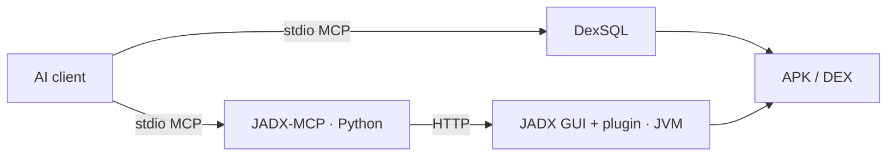

# DexSQL

[](https://madewithrea.com/builds/dexsql-sql-queries-and-mcp-server-for-apk-dex-analysis-by-ai-agents)

English | [简体中文](README.zh-CN.md)

**SQL for Android binaries.**

Query classes, methods, strings, and call references in APK and DEX files. Connect it to an AI agent through MCP, or use it from the command line.

[Playground](https://dexsql.lsposed.org) · [Documentation](https://dexsql.lsposed.org/docs) · [Download](https://github.com/LSPosed/dexsql-release/releases/latest) · [Install skill](skills/install-dexsql/SKILL.md) · [Benchmarks](benchmarks/README.md)

## Why DexSQL?

AI agents can combine signatures, strings and call relationships in one SQL query across DEX files, returning just the structured results they need. Queries can be generated, refined and saved in scripts for reuse.

DexSQL reads DEX directly and reuses loaded datasets, supporting repeated queries with low latency and a small memory footprint. See the [benchmarks](benchmarks/README.md) for measurements.

The built-in MCP server connects directly to agents, with no GUI required.



## Use with an AI agent

DexSQL is listed in the [official MCP Registry](https://registry.modelcontextprotocol.io/v0/servers?search=org.lsposed/dexsql) as `org.lsposed/dexsql`. Clients that install servers from the registry can add it directly, and Claude Desktop can open the `dexsql.mcpb` bundle from [Releases](https://github.com/LSPosed/dexsql-release/releases/latest). The bundle covers macOS, x86_64 Linux and x86_64 Windows; on other platforms, use the skill or manual setup below.

Install the setup skill with the [Skills CLI](https://github.com/vercel-labs/skills):

```sh
npx skills add LSPosed/dexsql-release --skill install-dexsql
```

Then ask your agent to use `install-dexsql` to install DexSQL and configure its MCP connection. In Codex, invoke it as `$install-dexsql`.

The skill downloads a compatible binary from [Releases](https://github.com/LSPosed/dexsql-release/releases/latest), verifies its SHA-256 checksum, adds the MCP configuration, and checks the connection. It can also use a local executable. The command above installs the skill; the agent performs the actual setup when you invoke it.

<details>
<summary>Manual MCP setup</summary>

Open [Releases](https://github.com/LSPosed/dexsql-release/releases/latest) and choose the executable or archive that matches your operating system and CPU architecture. Check the selected release's assets and notes for availability and system requirements. Extract the archive if needed, then rename the executable to `dexsql.exe` on Windows or `dexsql` on macOS/Linux. On macOS/Linux, run `chmod +x /path/to/dexsql`.

Save `LICENSE` and `LICENSE-AUXILIARY` from the same [Release](https://github.com/LSPosed/dexsql-release/releases/latest) alongside the executable, then register its absolute path. For Codex:

```sh
codex mcp add dexsql -- /absolute/path/to/dexsql mcp
```

For clients that use `mcpServers` JSON:

```json
{
  "mcpServers": {
    "dexsql": {
      "command": "/absolute/path/to/dexsql",
      "args": ["mcp"]
    }
  }
}
```

On Windows, use `dexsql.exe` and escape backslashes in JSON, for example `"D:\\Tools\\dexsql.exe"`. Reload the client's MCP connection if needed. See the [Codex MCP documentation](https://learn.chatgpt.com/docs/extend/mcp?surface=cli) for client settings.

</details>

Once connected, try:

> Open `/path/to/app.apk`. Find methods referencing this log message, list their callers, and show the relevant Smali.

The server provides its schema and documentation through MCP resources. APK parsing runs locally and leaves the input unchanged. The AI client's settings determine which results are sent to its model.

## Performance

### A real MCP session

An AI agent analyzed **Douyin 40.7.0** (343 MiB, 56 DEX files) through the DexSQL MCP server. We replayed its analysis goals on DexSQL 0.1.1 and six other tools: [rasc](https://github.com/MG1937/ASC/tree/rust) (the Rust implementation of ASC), [DexDec](https://github.com/asLody/dexdec), [ddc](https://github.com/ejfkdev/ddc), the [JADX](https://github.com/skylot/jadx) API, [garlic](https://github.com/neocanable/garlic) and [droidsaw](https://github.com/droidsaw/droidsaw).


Opening the APK once and answering 10 goals took 0.71 s with DexSQL, 1.69 s with rasc, 16 s with DexDec and from 75 s to 449 s with the others. DexSQL pays 0.38 s to open the APK once per session; rasc has no open but rereads the APK in every step, so a session with a single question finishes sooner with rasc. Some tools did not show all expected evidence; those misses are still under review. See the [replay report](benchmarks/agent-audit/README.md) for every goal, each tool's interface, the method and the harness.

### Fixed queries on QQ

Eight queries run against the same **QQ 9.3.55** APK, about 372 MiB: class and method lookup, string references, direct and two-hop callers, and compound predicates. The comparison includes [JADX](https://github.com/skylot/jadx), [zinja-coder's JADX-MCP](https://github.com/zinja-coder/jadx-ai-mcp), [ASC](https://github.com/MG1937/ASC), [DexDec](https://github.com/asLody/dexdec), [ddc](https://github.com/ejfkdev/ddc), [garlic](https://github.com/neocanable/garlic), and [droidsaw](https://github.com/droidsaw/droidsaw).


Startup time includes process launch, loading and preparation, and the first exact class lookup; values are medians of three runs. The OS file cache was not flushed.


Queries use the median of nine repeats across three prepared workflows. garlic restarts MCP for each call; that cost is included. droidsaw CLI uses three separate invocations, each including loading. Each query uses one linear chart starting at zero. Bars exceeding the axis limit are clipped, marked with an arrow and labeled with their actual time. **Hatched bars mean the query did not finish within 60 seconds.** Gray entries explain missing comparisons.

<details>
<summary>Call chains and compound predicates</summary>


Direct and two-hop queries return 15 and 16 methods. Each compound query returns one method. Every completed, plotted result set is checked. The JADX native adapter reads metadata and DEX instructions directly; it does not decompile the whole APK to find references.

</details>


Memory uses a 50 ms polling wait across the whole process tree. Light bars cover the common load-and-class-lookup workflow; dark bars cover each tool's executed cases. Summed RSS can count shared pages more than once. Private committed memory and the footprint at readiness are also recorded.

DexDec's reference cache makes its repeated caller query faster than DexSQL in this run. droidsaw's MCP rejects the input under its fixed parse budget, so its CLI is plotted. See the [report](benchmarks/README.md) for first-query and preparation times, interface differences, SQL, result hashes and reproduction scripts.

## CLI

```sh
dexsql query --input app.apk --sql "SELECT DISTINCT method FROM method_strings WHERE value = 'https://api.example.com'"
dexsql query --input app.apk --interactive
dexsql extract licenses --output THIRD_PARTY_NOTICES
dexsql --help
```

Repeat `--input` to query multiple files together. The same executable provides the CLI and MCP server.

## License

DexSQL is closed-source software from **LSPosed**, licensed under the [DexSQL Binary License 1.0](LICENSE). Personal and commercial use, integration, and binary redistribution are free under its terms.

The public installation skill, benchmark materials, and documentation use the [MIT License](LICENSE-AUXILIARY).

Third-party materials retain their own licenses. Run `dexsql extract licenses` to view their notices.
