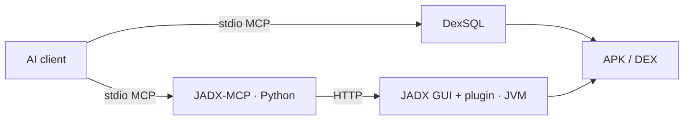
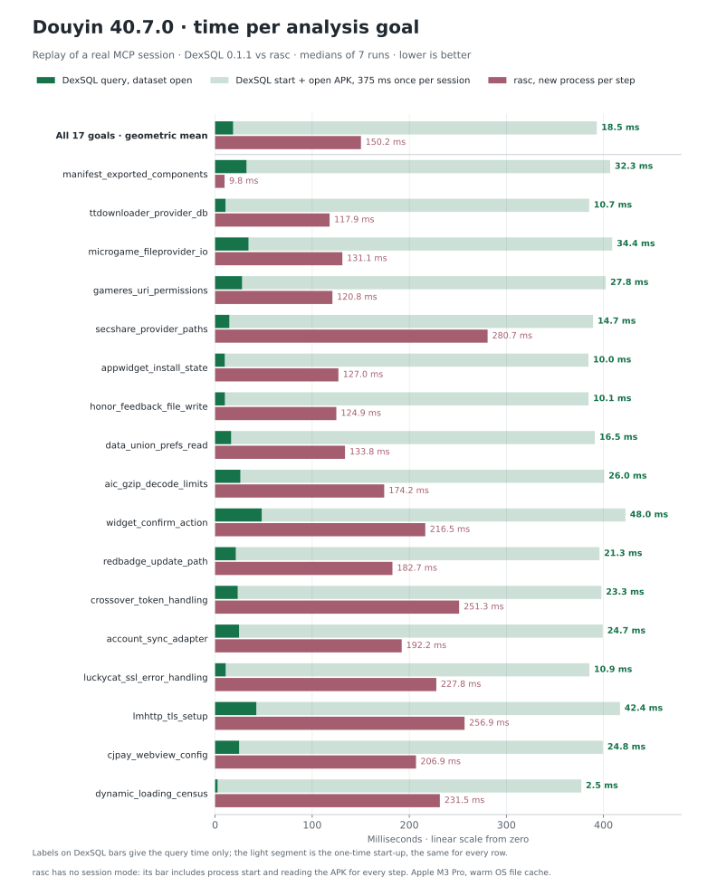

# DexSQL

[English](README.md) | 简体中文

**用 SQL 查 APK。**

查询 APK 和 DEX 中的类、方法、字符串和调用关系。可以通过 MCP 交给 AI 使用，也可以直接在命令行里查。

[Playground](https://dexsql.lsposed.org) · [文档](https://dexsql.lsposed.org/docs) · [下载](https://github.com/LSPosed/dexsql-release/releases/latest) · [安装 Skill](skills/install-dexsql/SKILL.md) · [性能测试](benchmarks/README.md)

## Why DexSQL?

AI agent 可以用一条 SQL 组合签名、字符串、调用关系等线索，跨 DEX 筛选代码，只返回需要的结构化结果。查询可动态生成、逐步细化，也能保存到脚本中复用。

DexSQL 直接读取 DEX，复用已加载的数据，以低延迟和较小的内存开销支持反复查询。具体实测见[性能测试](benchmarks/README.md)。

内置 MCP，直接接入 agent，无需启动 GUI。



## 接入 AI

DexSQL 已在[官方 MCP 注册表](https://registry.modelcontextprotocol.io/v0/servers?search=org.lsposed/dexsql)登记为 `org.lsposed/dexsql`。支持从注册表安装的客户端可以直接添加；Claude Desktop 可以打开 [Releases](https://github.com/LSPosed/dexsql-release/releases/latest) 中的 `dexsql.mcpb`。该安装包支持 macOS、x86_64 Linux 和 x86_64 Windows，其他平台请使用下面的 Skill 或手动配置。

通过 [Skills CLI](https://github.com/vercel-labs/skills) 安装配置 Skill：

```sh
npx skills add LSPosed/dexsql-release --skill install-dexsql
```

然后让 AI 使用 `install-dexsql` 安装 DexSQL，并配置 MCP 连接。Codex 中可以直接调用 `$install-dexsql`。

Skill 会从 [Releases](https://github.com/LSPosed/dexsql-release/releases/latest) 下载适合当前系统的二进制，校验 SHA-256，添加配置并验证连接，也支持使用已有的本地程序。上面的命令只安装 Skill，调用后才开始安装 DexSQL。

<details>
<summary>手动配置 MCP</summary>

前往 [Releases](https://github.com/LSPosed/dexsql-release/releases/latest)，根据自己的操作系统和 CPU 架构选择对应的可执行文件或压缩包。可用安装包及系统要求以所选 Release 的附件和说明为准。如为压缩包，先解压，再将可执行文件在 Windows 下重命名为 `dexsql.exe`，macOS/Linux 下重命名为 `dexsql`，并运行 `chmod +x /path/to/dexsql`。

将同一 [Release](https://github.com/LSPosed/dexsql-release/releases/latest) 中的 `LICENSE` 和 `LICENSE-AUXILIARY` 保存到可执行文件旁，再使用可执行文件的绝对路径注册。Codex：

```sh
codex mcp add dexsql -- /absolute/path/to/dexsql mcp
```

使用 `mcpServers` JSON 的客户端：

```json
{
  "mcpServers": {
    "dexsql": {
      "command": "/absolute/path/to/dexsql",
      "args": ["mcp"]
    }
  }
}
```

Windows 使用 `dexsql.exe`，JSON 路径中的反斜杠要转义，例如 `"D:\\Tools\\dexsql.exe"`。配置后按客户端要求重新加载 MCP 连接。Codex 的设置见[官方文档](https://learn.chatgpt.com/docs/extend/mcp?surface=cli)。

</details>

连上后可以这样问：

> 打开 `/path/to/app.apk`，找到引用这句日志的方法，列出调用者，再显示相关 Smali。

表结构和使用文档由服务通过 MCP 资源提供。APK 在本地解析，输入文件不会被修改；哪些查询结果会发给模型，取决于 AI 客户端的设置。

## 性能

### 一次真实的 MCP 会话

AI agent 通过 DexSQL MCP 分析了 **抖音 40.7.0**（343 MiB，56 个 DEX）。我们把这次会话里的 17 个分析目标（47 次工具调用）在 DexSQL 0.1.1 和 [rasc](https://github.com/MG1937/ASC/tree/rust)（ASC 的 Rust 实现）上重放。



热查询（两边都不算启动成本），单个目标 DexSQL 18.5 ms，rasc 142 ms（几何平均）；冷查询（两边都算上启动成本）分别是 397 ms 和 150 ms。DexSQL 每次会话只打开一次 APK（371 ms），之后 17 个目标合计 444 ms。rasc 没有会话模式，47 个步骤每一步都重新读取 APK。实测整场会话 DexSQL 用时 0.86 s，rasc 3.07 s。按这次重放的平均单目标耗时，打开成本在两到三个目标后就能收回；如果一次会话只问一个问题，rasc 更快结束。每个目标的数据、测试方法和脚本见[重放报告](benchmarks/agent-audit/README.md)。

### QQ 上的固定查询

在同一份 **QQ 9.3.55**（约 372 MiB）上跑了 8 条查询：类与方法定位、字符串引用、直接调用者、两跳调用链，以及几种组合条件。对比工具包括 [JADX](https://github.com/skylot/jadx)、[zinja-coder 的 JADX-MCP](https://github.com/zinja-coder/jadx-ai-mcp)、[ASC](https://github.com/MG1937/ASC)、[DexDec](https://github.com/asLody/dexdec)、[ddc](https://github.com/ejfkdev/ddc)、[garlic](https://github.com/neocanable/garlic) 和 [droidsaw](https://github.com/droidsaw/droidsaw)。


启动耗时包含进程启动、加载准备和首次精确类定位，取三轮中位数。测试未清空操作系统文件缓存。


查询取三轮准备后、共 9 次重复执行的中位数；garlic 每次调用都重启 MCP，耗时已计入。droidsaw CLI 取 3 次独立调用，每次都包含加载。每项查询只用一张从零开始的线性图，超出范围的柱子截断，用箭头标记并注明实际耗时。**斜线长柱表示查询在 60 秒内未完成。** 灰字注明缺少可比结果的原因。

<details>
<summary>调用链和组合条件</summary>


直接调用者和两跳调用者分别返回 15、16 个方法；三条组合查询各返回 1 个方法。所有已完成并绘柱的结果集合都经过核对。JADX 原生测试直接读元数据和 DEX 指令，没有为了查引用而反编译整个 APK。

</details>


内存按 50 ms 轮询间隔采样，包含整个进程树。浅色柱是统一的“加载并定位一个类”流程，深色柱是各工具实际执行用例的峰值。RSS 汇总工作集时可能重复计算共享页；私有提交内存、加载完成时的占用也保存在结果里。

这组查询里，DexDec 的引用缓存让重复调用者查询比 DexSQL 更快；droidsaw 的 MCP 因固定解析预算拒绝加载，图中使用它的 CLI。首次查询、准备时间、接口差异、完整 SQL、结果哈希和复现脚本都在[测试报告](benchmarks/README.md)中。

## CLI

```sh
dexsql query --input app.apk --sql "SELECT DISTINCT method FROM method_strings WHERE value = 'https://api.example.com'"
dexsql query --input app.apk --interactive
dexsql extract licenses --output THIRD_PARTY_NOTICES
dexsql --help
```

重复 `--input` 可同时查询多个文件。同一个可执行文件提供 CLI 和 MCP 服务。

## 许可证

DexSQL 是 **LSPosed** 的闭源软件，采用 [DexSQL Binary License 1.0](LICENSE)，允许按许可免费用于个人和商业用途、集成及二进制分发。

公开的安装 Skill、基准测试材料和文档采用 [MIT 许可证](LICENSE-AUXILIARY)。

第三方材料保留各自许可证，可运行 `dexsql extract licenses` 查看相关声明。
