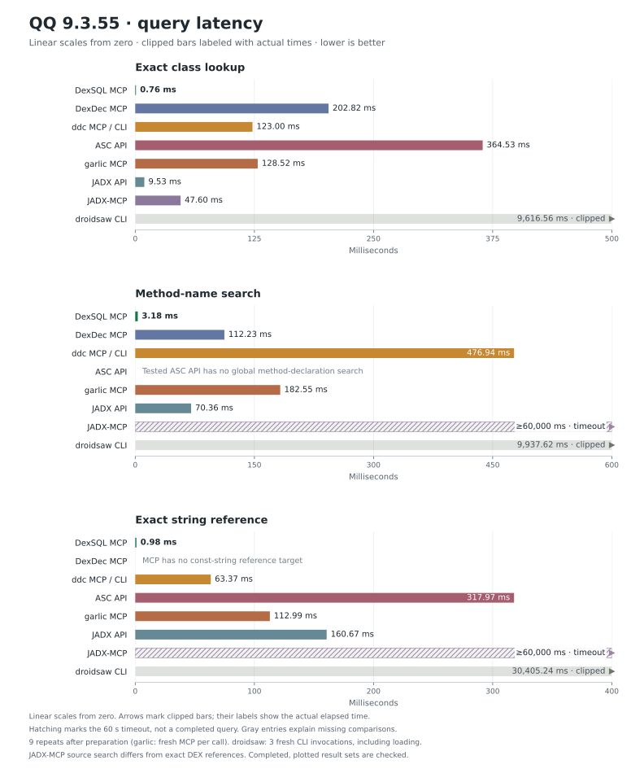
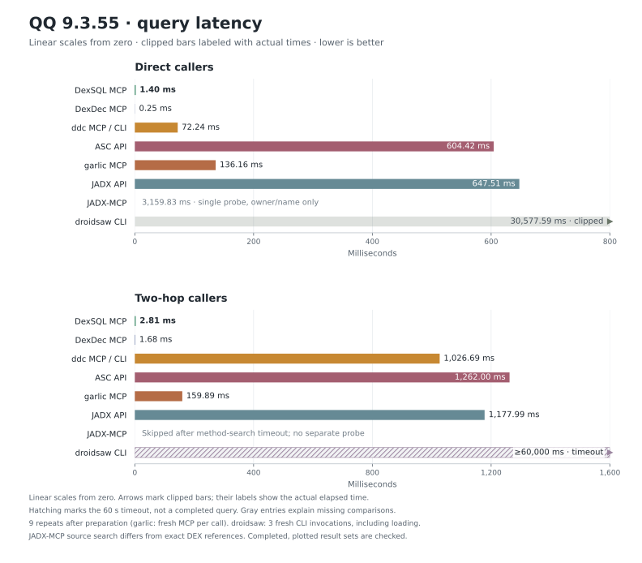
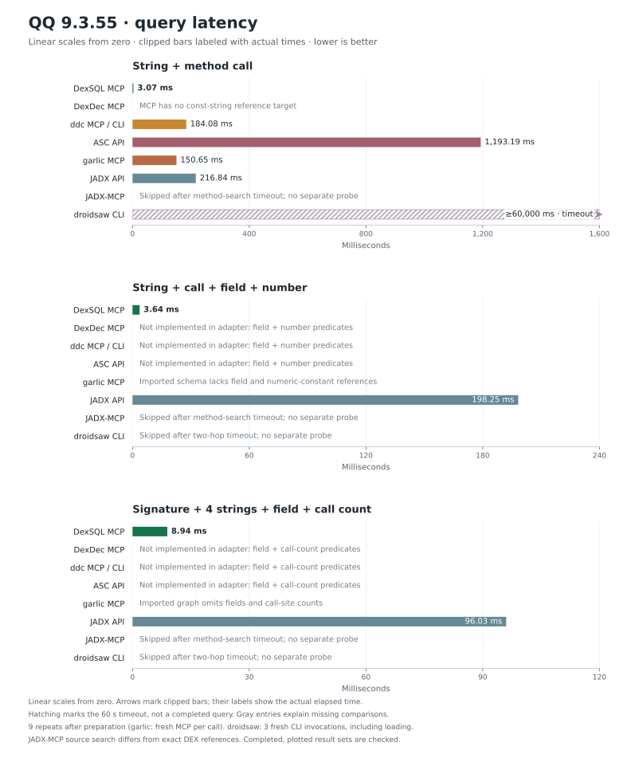
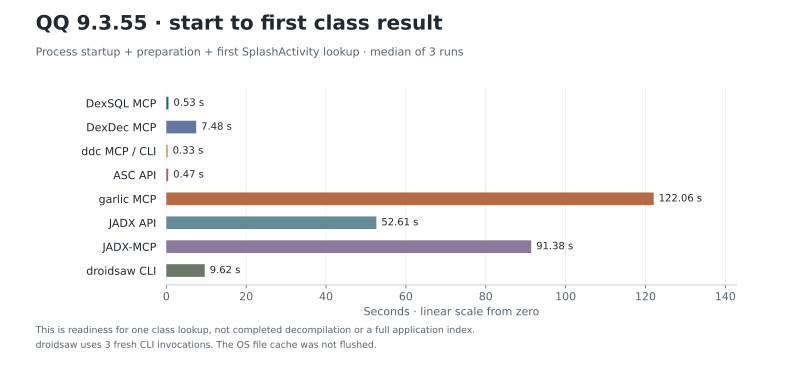
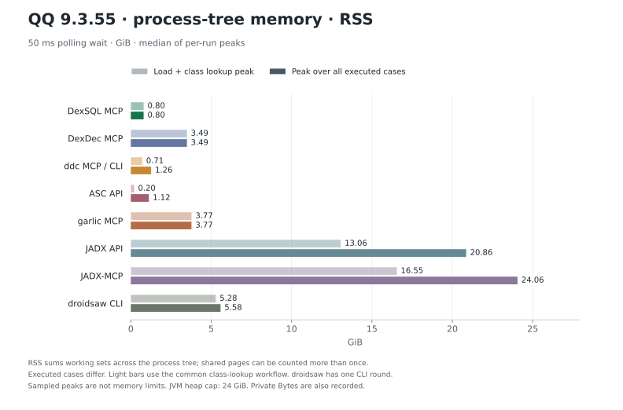
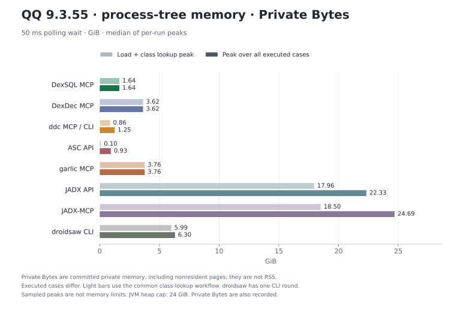

# QQ 9.3.55: query time and memory

[English README](../README.md) · [中文 README](../README.zh-CN.md) · [Measurements](qq-9.3.55-expanded.json) · [Runner](harness/expanded.py)

> See also: [replay of a real MCP reverse-engineering session](agent-audit/README.md) on Douyin 40.7.0 (DexSQL 0.1.1 and rasc, 17 goals).

The comparison includes DexSQL, JADX's native APIs, zinja-coder's JADX-MCP, ASC, DexDec, ddc, garlic, and droidsaw. It measures code-location queries and their process memory, not Java output quality or an AI model's reasoning time.

## Query time







Each query has a single linear chart starting at zero, measured in milliseconds. Axis limits keep the faster results readable. Bars exceeding the displayed range are clipped at its limit, marked with an arrow and labeled with the actual measured time; their clipped lengths do not represent the full duration. Hatched bars are also clipped and mean the query did not finish within the **60-second deadline**. Their labels show a lower bound, not a completion time. Gray entries explain missing comparisons and are excluded from speed comparisons.

The resident backends were started three times. DexSQL used three fresh processes sequentially; the multi-backend runs rotated backend order between rounds. Each case ran once to capture first-use cost, then three more times; the chart uses the median of those **nine repeated queries**. There is no additional discarded warm-up. Queries run sequentially, and earlier cases may populate caches used by later cases.

garlic was measured in a separate three-round run, with the same APK, machine and sampling settings. Each round generated a new call graph and imported a new DuckDB database. Each query then ran once followed by three measured repeats. The released MCP server exited on a second tool call in a persistent session, so every garlic tool call uses a fresh MCP process. Its query times include process launch, initialization, the server's DuckDB subprocesses, result decoding and shutdown; the database is reused on disk. Graph generation and import are counted in preparation and the first-answer chart.

droidsaw's CLI reparses the APK for each command. Its chart values are medians of **three independent invocations**, including loading, process launch, parsing and exit. Calling these values warm in-memory queries would be misleading. Its two-hop and string-plus-call workflows each have one independent deadline probe.

The OS file cache was not flushed. Downloads, installation and compilation are excluded. Result decoding, exact filtering and set composition are inside the query timer; sorting is also timed. Hashing and saving are outside it. All completed, plotted result sets match the corresponding DexSQL reference set; the JSON retains counts, hashes and individual samples. No timeout is converted to a speedup.

JADX-MCP source search has one independent timeout probe using the same APK, pinned versions and deadline. This probe did not sample memory and is excluded from the memory chart. The method-reference probe is independent of the method-search timeout.

That method-reference probe completed in **3,159.83 ms** after preparation, returning 15 owner/name pairs. Its complete result matches the owner/name projection of the exact caller set. It omits caller prototypes and is a single first-use probe, so its time is printed as a gray annotation instead of a repeated-query bar. It is not labeled as a timeout or a missing caller-search capability.

DexDec caches reference queries: its repeated direct-call query is faster than DexSQL in this run. The first-use timings remain in the JSON so that cache hits are not confused with the initial scan. This workload does not establish a fastest tool for every task.

### Fresh process to the first answer



This includes starting the process, preparing the backend and returning the first exact class result. It makes the loading costs visible alongside repeated-query times. It does not imply that all tools have finished the same amount of indexing or decompilation.

## Memory





The harness polls the entire backend process tree with a **50 ms wait between passes**. Sampling work and OS scheduling add to the actual gap. That includes DexSQL child processes, ASC's worker pool, garlic's graph extractor and DuckDB subprocesses, and both the JVM and Python server for JADX-MCP. The harness itself is excluded. The JSON also records memory at readiness and after the first query. garlic has no resident process between tool calls; its preparation and query peaks are still included in the workflow measurements.

The light bars cover the common workflow of starting the backend and locating `SplashActivity`. The dark bars cover all cases actually executed in that round, including a timed-out query where applicable. Tools execute different subsets, so the dark bars are not an equal-work ranking. The chart uses the median of the three per-round peaks; droidsaw CLI has one measured workflow containing three invocations per completed case.

**RSS** is the sum of process working sets: shared pages can be counted more than once. **Private Bytes** is Windows private committed memory, which includes nonresident pages and is not the same as physical RAM. These are sampled peaks, so short-lived peaks between samples can be missed. They exclude the OS file cache.

Both JADX configurations use `-Xmx24g`. The observed footprint depends on this heap allowance and garbage collection; it is not a claim about the minimum RAM needed to run JADX.

## Interfaces and limitations

- **DexSQL 0.1.0:** actual stdio MCP, `initialize` → `open_dataset` → `query`, with `--max-dex-bytes 2147483648` and server timeout `--timeout-ms 120000`; the harness still enforces its shorter 60-second query deadline. Each SQL statement returns a complete result set with truncation checked.
- **JADX 1.5.6 API:** [JadxProbe.java](harness/JadxProbe.java) uses indexed class lookup, declared-method metadata and DEX instruction visitors. Calls are matched by full descriptors. Compound searches first narrow candidates by strings or signature, then inspect calls, fields and constants. It does not decompile the whole APK to answer metadata questions or add an external search index.
- **[JADX-MCP V6.4.1](https://github.com/zinja-coder/jadx-ai-mcp/releases/tag/V6.4.1):** the official unmodified plugin and matching Python server, with a real JADX `MainWindow`. The adapter hides its window, disables automatic background decompilation, and waits for the input-load event. Class substring search is followed by an exact filter. Source-text search is broader than a DEX string-reference query. The method-reference route matches method names and includes overrides, while its returned caller identities omit prototypes; this is not the same as exact DEX call edges.
- **[ASC 0.1.1.post5](https://github.com/MG1937/ASC):** a small JSON-lines adapter calls its unmodified APK loader and reference-search workers with eight workers. `get_class_dex` handles exact class lookup. Reference search uses non-aggregated output to preserve prototypes, filters exact matches, and composes result sets in Python. ASC scans compressed input again on a new query. The tested adapter does not implement a global declaration search or the two richer compound predicates.
- **[DexDec 1.0.2](https://github.com/asLody/dexdec/releases/tag/v1.0.2):** the official Windows `dexdec-mcp` binary, `open_project`, `search_symbols`, and exact `find_references`. The search cap is checked. Its MCP reference tool exposes class, field and method targets, but no const-string target. No decompile-and-parse substitute was used for the string cases.
- **[ddc 0.1.29](https://github.com/ejfkdev/ddc/releases/tag/v0.1.29):** actual stdio MCP for classes and references. The global method-declaration search uses the official `members --method` CLI because that command is not exposed by this release's ten MCP tools. Method references are filtered by full descriptors. Two-hop calls compose the required per-owner queries; each composed case shares a single 60-second deadline.
- **[garlic 1.8](https://github.com/neocanable/garlic/releases/tag/v1.8-release):** the official `garlic-win64.exe`, with [DuckDB CLI 1.5.6](https://github.com/duckdb/duckdb/releases/tag/v1.5.6). The [adapter](harness/garlic.py) uses `call_graph` → `cg_import` → `cg_query`, without Java decompilation. Class and method searches project owners from graph method descriptors; this is not a complete declaration index, so the result checks establish equivalence for these selected cases. String and call queries join the imported tables using full descriptors. Field-access and numeric-constant references are absent from this schema, and call edges are deduplicated, so the two richer predicates are not measured. A diagnostic with two consecutive `cg_query` calls completed the first and exited with Windows status `0xC0000005` on the second. The fresh-process workaround is timed; the binary is unmodified. APK graph extraction is serial in this release. Import uses the server's fixed four threads and 4 GB DuckDB memory limit; measured SQL queries request eight threads.
- **[droidsaw 2.0.0](https://github.com/droidsaw/droidsaw):** installed from the pinned crates.io release with its MCP feature. MCP loading was attempted three times and rejected this APK with `parse budget exhausted (Memory) at dex-parse-input`: the MCP loader has a fixed 100 MiB parse budget, with no budget override exposed by this server's command line. This is a configured budget rejection, not system out-of-memory or a timeout. The graph therefore uses the unmodified CLI with its default 4 GiB parse budget, `--no-auto-splits`, declared-method mode (`--implementations`) and regex xrefs. A parse budget is not a process RSS cap. CLI loading is included in every timing.

These interfaces perform different amounts of preparation. droidsaw loads a cross-layer APK context; some other backends defer work until a query. Their readiness and first-use times are retained separately. The plots compare the available workflows, not isolated implementations of the same parser algorithm.

Gray annotations give the reason for each missing comparison: the tested interface does not expose the required query, the benchmark adapter does not implement the named predicates, or an earlier timeout ended the run before that case. The latter cases had no separate probe; they are not labeled as timeouts themselves. These are limits of this benchmark and the tested interfaces, not claims that a tool could never answer the question with additional scripting or decompiled-code analysis. No Java decompilation-quality comparison was attempted.

## The eight cases

Queries come from the existing `qq_9_2_90` corpus and are applied here to QQ 9.3.55. This is a deliberate set of reverse-engineering tasks, not a random or exhaustive benchmark. The exact [SQL is included in the JSON](qq-9.3.55-expanded.json).

1. **Class lookup:** `round104/q03_splash_activity_exact.sql`, unchanged. Find `Lcom/tencent/mobileqq/activity/SplashActivity;`. Result: **1 class**.
2. **Method name:** `round105/q03_match_payload.sql`, adapted from exact method names to case-insensitive substring matching and distinct owner classes. This aligns with the JADX-MCP result shape. Result: **43 classes**.
3. **String reference:** the anchor from `round2/q_seed_info.sql`, projected to distinct owners of methods that load the exact string `closeQuietly(): Exception when connHttp.getInputStream()!,There may be no network, or no INTERNET permission`. Result: **1 class**. JADX-MCP instead attempts its available source-text search and is marked accordingly.
4. **Direct callers:** the structure of `round1/q07_call_direct.sql`, with target changed to the corpus's byte-unit helper, `Liu3/a;->a(JZ)Ljava/lang/String;`, and the result limit removed. The internal target can also be located by GUI-backed tools. Result: **15 methods**.
5. **Two-hop callers:** `round1/q09_two_hop_calls.sql`, with the same target substitution and no 50-row limit. Return methods that call any direct caller. Full prototypes are retained at both hops. Result: **16 methods**.
6. **String + call:** [round12/exact_string_call.sql](harness/queries/string_call.sql), unchanged. Find methods loading `gifFilePath gifPath:` and invoking `Bitmap.getWidth()I`. Result: **1 method**.
7. **Four facts:** [round12/four_fact_exists.sql](harness/queries/four_fact.sql), unchanged. Add access to `Point.x:I` and the numeric constant `99`. The comparison projects the method descriptor from the SQL's method-and-class result. Result: **1 method**.
8. **Complex search:** [round13/complex_full.sql](harness/queries/complex.sql), unchanged. Require `(JZ)String`, all four byte-unit strings, `Math.round(D)J`, `RoundingMode.HALF_UP`, at least two matching call sites, and the original exclusion predicates. The SQL exercises CTEs, `INTERSECT`, `EXCEPT`, `UNION`, aggregation and correlated subqueries. Result: **1 method**.

Class results normalize descriptor/dotted names and inner-class presentation before sorting and hashing. Method results keep canonical DEX owner, name and full prototype. Hashing uses sorted, deduplicated, compact UTF-8 JSON. The checks compare result identities, not instruction offsets or the quality of reconstructed Java.

## Machine and provenance

- AMD Ryzen 9 9950X3D, 16 cores / 32 threads; 64 GiB installed RAM; Windows 11 Pro 10.0.26200.
- `QQ_9.3.55.apk`: **389,727,209 bytes**, 41 `classes*.dex` entries totaling 411,819,364 uncompressed bytes.
- APK SHA-256: `e5752cad5274f8c28291d9fba91a99cbdb856cb49fdfea9803770f1d6d8e00dc`.
- DexSQL v0.1.0 Windows x64 release build: source revision `77988ee4bfaf4d4bc162a405cc97ac9faa0a4c12`; executable `dexsql-windows-amd64.exe`, **21,365,760 bytes**.
- DexSQL executable SHA-256: `f354ebcf715de9a66ef8ebe08b2b36807ab58e25cd5a1c0812e497fc1fcfc448`.
- ASC: `a458f41a42a8ecfc29e9f4fa202b8374243a67af`; DexDec: `6c083d91f5b5541ca56b4d2775228b5123bdb72f`; droidsaw: `50eb045b5672431ea787c2696100baed44163918`; JADX-MCP: `d2dd72e6c0d84735b78773067075dac8cea651c1`.
- garlic: `b3dce15c7911cc8698c9a1a693975be13ff41546` (`v1.8-release`); DuckDB CLI: `v1.5.6`, build `069cc9f9b5`. The binary and dependency hashes are recorded in the JSON.
- Java 26.0.1; CPython 3.14.6; psutil 7.2.2. The MCP Python environment is recorded in [python-packages.txt](python-packages.txt).
- Eight workers requested where exposed: DexSQL/ASC arguments, JADX settings and common fork-join pool, and `RAYON_NUM_THREADS=8` for Rust backends. Internal command implementations can still run serially.

The JSON contains per-backend measurement dates, executable hashes, all timings, memory values, error outcomes and result digests. Raw APK contents, decompiled code and full answer lists are not redistributed. Source data for the independent JADX-MCP source-search probe are in [qq-9.3.55.json](qq-9.3.55.json). That file also contains a separate three-tool experiment using a different DexSQL build; its DexSQL timings are not used in these charts.

## Reproduce

Use a fresh working directory outside the repository. Install the pinned tools and supply your own matching APK. The runner needs `psutil`; ASC needs its own Python environment. The official JADX-MCP server also needs its release requirements. For garlic, provide the paths to both the release executable and `duckdb.exe`; the adapter adds DuckDB to the child process's PATH without changing the user's environment.

Compile [JadxProbe.java](harness/JadxProbe.java) against the JADX 1.5.6 all-in-one JAR. Install the V6.4.1 plugin in an isolated `JADX_CONFIG_DIR`, and use the matching server archive. A graphical Windows session is still needed for its hidden GUI. Do not run another instance of the plugin on the same port.

```powershell
python -m pip install psutil==7.2.2
javac -cp C:\tools\jadx-1.5.6-all.jar -d C:\bench\classes .\harness\JadxProbe.java
cargo install droidsaw --version 2.0.0 --features mcp --locked --root C:\bench\droidsaw
```

Copy [config.example.json](harness/config.example.json) outside the repository and replace its paths. Run each command sequentially, with no other benchmark or build running:

```powershell
python .\harness\expanded.py --config C:\bench\config.json --out C:\bench\main --backends dexsql,jadx-core,dexdec,ddc,asc,jadx-mcp,droidsaw --trials 3 --warm 3
python .\harness\expanded.py --config C:\bench\config.json --out C:\bench\droidsaw-cli --backends droidsaw-cli --trials 1 --warm 2
python .\harness\expanded.py --config C:\bench\config.json --out C:\bench\droidsaw-compound --backends droidsaw-cli --cases string_call --trials 1 --warm 2
python .\harness\expanded.py --config C:\bench\config.json --out C:\bench\mcp-callers --backends jadx-mcp --cases callers --trials 1 --warm 1
python .\harness\expanded.py --config C:\bench\config.json --out C:\bench\mcp-string --backends jadx-mcp --cases string --trials 1 --warm 1
python .\harness\expanded.py --config C:\bench\config.json --out C:\bench\garlic --backends garlic --trials 3 --warm 3
```

Each output directory must be new. A timeout ends that backend's current process; later cases in that process are not silently marked as timed out. The separate commands test the remaining workflows independently. For a quick DexSQL-only check, use `--backends dexsql --trials 1 --warm 1`.

To run the full DexSQL benchmark independently, point the config's `dexsql` path to the release executable identified above:

```powershell
python .\harness\expanded.py --config C:\bench\config.json --out C:\bench\dexsql --backends dexsql --trials 3 --warm 3
```

Charts are generated in English from the recorded compact JSON by [render_charts.py](render_charts.py). It needs Matplotlib; `--preview-dir` writes PNG previews outside the repository. The benchmark code is an adapter and does not contain DexSQL engine source.

These benchmark materials are licensed under [MIT](LICENSE). The compared tools and input APK retain their own licenses and are not included here.
