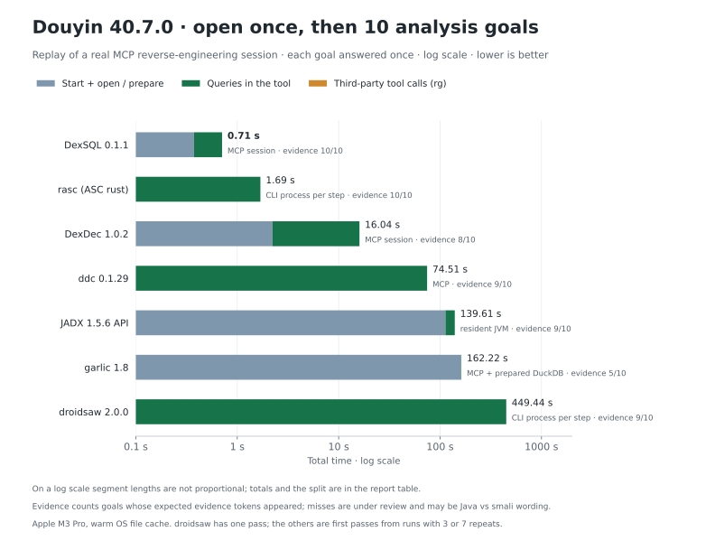
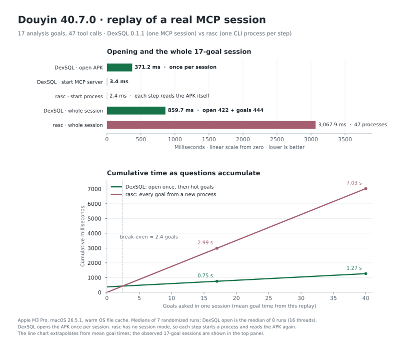

# Douyin 40.7.0: replay of a real MCP reverse-engineering session

[Benchmarks](../README.md) · [Harness](harness/) · [Measurements](data/) · [Chart](render_chart.py)

An AI agent analyzed Douyin 40.7.0 through the DexSQL MCP server, using DexSQL as its only APK and code analysis tool. From that session we took **17 analysis goals**, the steps the agent used to reach the evidence for each one (**47 tool calls** in total), and replayed them on:

- **DexSQL 0.1.1** as an MCP server: one dataset opened once, then every goal in the same session.
- **rasc**, the Rust implementation of [ASC](https://github.com/MG1937/ASC) on its `rust` branch, as a CLI. rasc has no session or batch mode, so every step is a new process.

Five more tools replayed 10 of the goals; see [More tools](#more-tools-10-shared-goals). This is a single real workload, not a general ranking. The [QQ benchmark](../README.md) covers more tools on fixed queries.

## Results






Render with `python3 render_chart.py` (requires matplotlib).

| Measurement | DexSQL 0.1.1 | rasc | Ratio |
|---|---:|---:|---:|
| **Whole session:** all 17 goals, observed end to end | **860 ms** | 3,068 ms | DexSQL 3.6× faster |
| **Per goal, hot:** start-up excluded on both sides, geometric mean | 18.5 ms | 142.4 ms | DexSQL 7.7× faster |
| **Per goal, cold:** start-up included on both sides, geometric mean | 396.8 ms | 150.2 ms | **rasc 2.6× faster** |
| **Opening the APK** | 371 ms, once per session | none; each step reads the APK | — |

- The DexSQL whole-session time is one new MCP process that initializes (4 ms), opens the APK (422 ms), runs all 17 goals (444 ms) and closes. rasc runs the same goals as 47 processes. Medians of 7 trials.
- Hot: DexSQL runs the goal on the open dataset; rasc runs it with its 2.4 ms per-process start subtracted, still reading the APK as it always does. Cold: DexSQL starts the MCP server (3.4 ms), opens the APK and runs the goal; rasc starts a new process for every step.
- Opening the APK in DexSQL takes 371 ms (median of 8 runs) and is paid once per session, however many goals follow. rasc does not pay a separate open; each command reads what it needs from the APK. Using the mean goal time from this replay, the open is recovered after two to three goals, so a session with a single question finishes sooner with rasc.
- DexSQL is slower on one goal: listing exported manifest components takes 32.3 ms, compared with 9.8 ms for rasc.

### Per goal

Times are medians of 7 runs in randomized order. DexSQL is measured after the dataset is open. rasc includes process start for every step, measured at 2.4 ms per process.

| Goal | DexSQL calls | rasc processes | rasc ms | DexSQL ms | rasc / DexSQL |
|---|---:|---:|---:|---:|---:|
| `manifest_exported_components` | 1 | 1 | 9.8 | 32.3 | 0.3× |
| `ttdownloader_provider_db` | 2 | 2 | 117.9 | 10.7 | 11.0× |
| `microgame_fileprovider_io` | 4 | 2 | 131.1 | 34.4 | 3.8× |
| `gameres_uri_permissions` | 3 | 2 | 120.8 | 27.8 | 4.4× |
| `secshare_provider_paths` | 3 | 4 | 280.7 | 14.7 | 19.1× |
| `appwidget_install_state` | 2 | 2 | 127.0 | 10.0 | 12.7× |
| `honor_feedback_file_write` | 2 | 2 | 124.9 | 10.1 | 12.4× |
| `data_union_prefs_read` | 2 | 2 | 133.8 | 16.5 | 8.1× |
| `aic_gzip_decode_limits` | 3 | 3 | 174.2 | 26.0 | 6.7× |
| `widget_confirm_action` | 4 | 3 | 216.5 | 48.0 | 4.5× |
| `redbadge_update_path` | 3 | 3 | 182.7 | 21.3 | 8.6× |
| `crossover_token_handling` | 3 | 4 | 251.3 | 23.3 | 10.8× |
| `account_sync_adapter` | 3 | 3 | 192.2 | 24.7 | 7.8× |
| `luckycat_ssl_error_handling` | 3 | 3 | 227.8 | 10.9 | 20.9× |
| `lmhttp_tls_setup` | 5 | 5 | 256.9 | 42.4 | 6.1× |
| `cjpay_webview_config` | 3 | 3 | 206.9 | 24.8 | 8.4× |
| `dynamic_loading_census` | 1 | 3 | 231.5 | 2.5 | 90.9× |

Each goal is described in the harness (`intent` in [rasc_replay.py](harness/rasc_replay.py)). Most follow the same shape: find a string, method or class, then read the code around it.

## More tools: 10 shared goals

Five more tools replayed 10 of the 17 goals through their own interfaces. Each goal is answered once after the tool is ready, as in an agent session. Totals below are start-up or preparation plus that first pass; the chart above uses a log scale.

| Tool | Interface | Start + open / prepare | 10 goals | Third-party calls | Total | Evidence |
|---|---|---:|---:|---:|---:|---:|
| **DexSQL 0.1.1** | MCP session | 0.38 s | 0.33 s | — | **0.71 s** | 10/10 |
| rasc (ASC `rust`) | CLI, process per step | — | 1.69 s | — | 1.69 s | 10/10 |
| [DexDec](https://github.com/asLody/dexdec) 1.0.2 | MCP session | 2.23 s | 13.81 s | — | 16.04 s | 8/10 |
| [ddc](https://github.com/ejfkdev/ddc) 0.1.29 | MCP | — | 74.51 s | — | 74.51 s | 9/10 |
| [JADX](https://github.com/skylot/jadx) 1.5.6 API | resident JVM, `-Xmx24g` | 113.05 s | 26.57 s | — | 139.61 s | 9/10 |
| [garlic](https://github.com/neocanable/garlic) 1.8 | MCP over prepared DuckDB | 161.40 s | 0.76 s | 0.06 s (rg) | 162.22 s | 5/10 |
| [droidsaw](https://github.com/droidsaw/droidsaw) 2.0.0 | CLI, process per step | — | 449.44 s | — | 449.44 s | 9/10 |

- **Steps per tool.** Each tool locates the string, method or class, then reads the code around it in its own form: DexSQL decodes smali, the decompilers return Java. ddc's `getclass` decompiles a class per call (about 4.9 s each here). garlic decompiles the whole APK and imports a call graph into DuckDB before the first query, then reads the identified Java files with `rg`; that is the third-party segment. droidsaw rereads the APK in every process.
- **Evidence** counts goals in which all expected tokens appeared in the tool's output. The tokens were taken from the original smali-based session, so some misses may be differences in Java output rather than missing information. We have not yet reviewed them: `LuckyCatAuthBridge` (ddc, DexDec), `JS2NativeBridge` (JADX API, droidsaw, garlic), `downloadUrl TEXT` (DexDec, garlic), and for garlic also the manifest components and three tokens in two goals.
- **Repeats.** DexDec, ddc, JADX API and garlic ran 3 passes, DexSQL and rasc 7; this table uses each tool's first pass. droidsaw ran one pass, about 16 s per process. For droidsaw 2.0.0 one exact inner-class descriptor was rejected, so the replay opens the enclosing class instead ([data](data/tools/droidsaw-failed-calls.json)).
- **Not included yet:** JADX-MCP 6.4.1. Its run returned no usable evidence for any goal and is being repeated.

Per-tool measurements are in [data/tools/](data/tools/) and the replay scripts in [harness/tools/](harness/tools/). DexSQL and rasc figures in this table come from the 17-goal runs above, restricted to the same 10 goals.

## Setup

- **Input:** Douyin (`com.ss.android.ugc.aweme`) 40.7.0, version code 400701; 359,908,938 bytes; SHA-256 `99c4a66daa3d7cb8d1ca3caa47e7f9b46dcde5825d0d2f694bb479a249bd2a2a`. 56 DEX files, 567,192 classes.
- **Machine:** Apple M3 Pro (6 performance + 6 efficiency cores), 36 GiB RAM, macOS 26.5.1.
- **DexSQL:** official 0.1.1 release, `dexsql-darwin-arm64`, build `0.1.1+6ac7870875a519ec471e41c93fc86d80e8e2bce7`, SHA-256 `d983de33007e11c56e681aaa238ae15637eff961623335f1131527f8d2c82a77`. MCP over stdio with `compact: true` responses.
- **rasc:** [MG1937/ASC](https://github.com/MG1937/ASC/tree/rust) commit `e809c7b4b454ebc8eb4467f56d44a82e6139472b`, release build with fat LTO.

## Method

- **Same evidence, each tool's own steps.** For every goal, both tools must produce the same expected evidence before timing starts; missing evidence fails the run. Step counts may differ because the interfaces differ. Goals are not merged into one precomputed scan.
- **Each tool in its supported mode.** DexSQL keeps one dataset open across goals, which is how its MCP server is meant to be used. rasc is CLI only, so each step is a separate process. 
- **Threads chosen per tool.** rasc uses 12 threads, its fastest setting for whole-APK string search. DexSQL uses 16, chosen from a sweep of 0 (automatic), 1, 2, 4, 8, 12 and 16 threads using APK open plus the `ttdownloader_provider_db` goal. That goal is also part of the suite. With automatic threads, open plus that goal took 499 ms instead of 412 ms.
- **Timing.** Goal order is shuffled with a fixed seed; each goal runs 7 times. The OS file cache was warm and not flushed. Output formatting is included; output is discarded during timing and checked in a separate validation pass.
- **Excluded:** the full class inventory. rasc prints all classes in one command; the DexSQL MCP server pages results and cannot return all 567,192 classes in one response.
- **Not measured:** memory, other platforms and APKs. We plan to add them. Five more tools are compared on 10 of the goals in [More tools](#more-tools-10-shared-goals).

Query results are not published. They can be reproduced from the APK with the harness.

## Reproduce

```sh
cd harness
export APK=/path/to/douyin-40.7.0.apk
export DEXSQL=/path/to/dexsql        # 0.1.1 release binary
export RASC=/path/to/rasc            # built from MG1937/ASC@e809c7b

python3 dexsql_replay.py             # thread sweep, startup, per-goal medians
python3 rasc_replay.py               # per-goal medians
python3 whole_suite.py               # whole session for both tools
```

Results are written to `harness/results/`. The published measurements are in [data/](data/).
